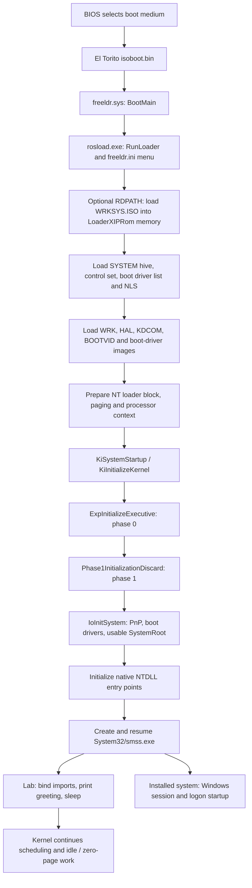

# Windows Research Kernel boot process

Historical build/VM results below describe the recorded experiments. Generated
evidence, media, VM files, and build outputs were removed during cleanup; rebuild
and rerun to collect fresh evidence.

This guide traces the current **WRK 1.2 x86 / NT 5.2** boot from BIOS media to
the first native user process. It describes the files and functions in this
checkout, the separate installed-Windows route, and the recorded RAM-disk
experiment. Component responsibilities are in [components.md](components.md);
failure diagnosis and remedies are in [failures.md](failures.md).

The latest retained experiment, dated **2026-10-03**, reaches
`Hello world from WRK SMSS!` with the actual WRK kernel. This is an explicit
text-mode-setup boot with generated hives, a supplied Microsoft HAL, and
ReactOS-derived support modules. It does not establish a normal installed
Windows boot, a working Windows desktop, or a general Session Manager.

## Boot routes and their current status

| Route | System root and loader | Verified boundary in this checkout |
| --- | --- | --- |
| Installed Windows Server 2003 SP1 x86 | Installed Windows runtime; stock NTLDR and `boot.ini`, or FreeLoader with `BootType=Windows2003` | Documented integration baseline; no retained successful installed-system WRK run |
| Original FreeLoader payload ISO | `artifacts/wrk-freeldr/WRK-FreeLoader.iso`; FreeLoader expects `multi(0)disk(0)rdisk(0)partition(1)\WINDOWS` on the VM disk | FreeLoader runs; blank disk stops at `Could not load SYSTEM.ALT hive!` **before the kernel is loaded** |
| Normal Hello RAM-disk ISO | FreeLoader loads an inner `WRKSYS.ISO` as `ramdisk(0)\WRK`; generated normal-mode hives | WRK starts, then stops at `0x9A (4, C0000034, 0, 0)` because `SYSTEM\Setup\SystemPrefix` is missing |
| Setup Hello RAM-disk ISO, with arbiter and RAMDISK repairs | Same memory system root; `SetupMode=Text` and matching setup hives | Native SMSS greeting verified; no bugcheck in the retained 180-second run |
| Educational `bootloader/` lab | Raw two-stage BIOS floppy image; optional first-hard-disk MBR chainload | Boots its own menu, not WRK; does not build the NT handoff environment |

Evidence for the first three experimental boundaries is in
[FREELOADER.md](FREELOADER.md) and [WRK_HELLO_BOOT.md](WRK_HELLO_BOOT.md).
The successful run is
wrk-hello-20261003-setup-pnp (`artifacts/wrk-hello-20261003-setup-pnp/verification/result.json`).
These are retained results, not new VM tests performed while writing this guide.

## End-to-end flow



The diagram follows the FreeLoader ISO route implemented here. A stock
installed Windows disk has its own boot sectors and NTLDR instead of
`isoboot.bin`/FreeLoader/rosload. The common boundary is the prepared NT loader
block passed to the WRK kernel, not a direct BIOS jump into `wrkx86.exe`.

## 1. BIOS and boot media

The current VM tests use BIOS, i386, non-PAE paging, one CPU, ACPI and I/O APIC.
The Hello runner uses 512 MB RAM, VBoxVGA, an IDE-attached CD and no hard disk:
see [Test-WrkHelloVm.ps1](../tools/Test-WrkHelloVm.ps1). The MP ACPI HAL remains
the supplied Server 2003 SP1 `HALMACPI.DLL`, even with one virtual CPU.

For the external Hello ISO,
[New-WrkHelloIso.ps1](../tools/New-WrkHelloIso.ps1) uses `mkisofs` to create an
ISO9660/Joliet disc with a no-emulation El Torito boot image at
`loader/isoboot.bin`. The ISO bootstrap source,
[isoboot.S](../_bootldr/freeldr/bootsect/isoboot.S), starts in real mode, relocates
its 2048-byte image from `0x7C00`, uses BIOS disk services to read ISO9660
directories, finds FreeLoader and transfers control to it. With a valid first
hard-disk MBR, this bootstrap can offer a keypress choice and otherwise boot
that disk; the CD-only Hello VM has no such installed-disk fallback.

The external disc holds `loader/{freeldr.sys,rosload.exe,isoboot.bin,freeldr.ini}`,
a root `freeldr.ini`, licenses, and `WRKSYS.ISO`. The **inner ISO** holds the
`WRK\System32` system directory. The original FreeLoader ISO instead holds a
`payload\` directory for guest installation and expects an existing system
root on disk; payload files alone are not a bootable Windows environment.

The separate [BIOS bootstrap lab](BOOTLOADER.md) reads its second stage from
a raw floppy layout and can chainload a disk MBR. It supplies no SYSTEM hive,
PE imports, paging structures, or NT loader parameter block and therefore
cannot start WRK itself.

## 2. FreeLoader and the boot menu

[entry.S](../_bootldr/freeldr/freeldr/arch/i386/entry.S) enters the loader's
protected-mode code and calls `BootMain`.
[freeldr.c](../_bootldr/freeldr/freeldr/freeldr.c) initializes the machine,
loader memory manager, filesystem readers, PE module list and boot devices.
`LaunchSecondStageLoader` loads `rosload.exe`, looking beside the loader and
then under `loader\`, and calls its PE entry point. Keep both loader binaries
from the same build.

The second stage's `RunLoader` in
[bootmgr.c](../_bootldr/freeldr/freeldr/bootmgr.c) reads `freeldr.ini`, shows the
configured operating systems and dispatches a selected `Windows2003` entry
to `LoadAndBootWindows`. A menu or a loader serial message proves only that
these stages ran; it is not proof of kernel entry.

The Hello packager produces this entry, with the actual inner-image length
substituted for `<bytes>`:

```ini
[WRKHello]
BootType=Windows2003
SystemPath=ramdisk(0)\WRK
Kernel=wrkx86.exe
Hal=halmacpi.dll
Options=/SOS /MININT /INRAM /RDEXPORTASCD /RDPATH=\WRKSYS.ISO /RDIMAGELENGTH=<bytes> /NOPAE /NOEXECUTE=ALWAYSOFF /FASTDETECT
```

`-TextModeSetup` adds `SetupMode=Text`. Inspect the generated `freeldr.ini` when
diagnosing a particular ISO. Options in `/KERNEL=` and `/HAL=` take precedence
over the separate `Kernel=` and `Hal=` values. The loader still registers the
loaded images as `ntoskrnl.exe` and `hal.dll` so that their imports bind.

For the installed route, use the real ARC path of a compatible Windows
Server 2003 SP1 x86 installation. Under stock NTLDR, add a separate guest
`boot.ini` entry selecting `/kernel=wrkx86.exe /hal=halmacpi.dll`; retain the
stock entry. Microsoft documents NTLDR's menu/default selection from
`boot.ini` and identifies NTLDR, NTDETECT, `boot.ini` and optional NTBOOTDD as
the installed system's core boot files. Those Microsoft loader binaries are
not built by this checkout.
([NTLDR and boot.ini](https://learn.microsoft.com/en-us/troubleshoot/windows-server/setup-upgrade-and-drivers/manually-edit-boot-file),
[Server 2003 boot files](https://learn.microsoft.com/en-us/windows/win32/vss/backing-up-and-restoring-system-state-under-vss))
The guest copy/configuration steps are in [VIRTUALBOX.md](VIRTUALBOX.md) and
[INSTALL.TXT](../tools/guest/INSTALL.TXT); they apply inside the guest.

## 3. System image, SYSTEM hive and NLS

`LoadAndBootWindows` in
[winldr.c](../_bootldr/freeldr/freeldr/ntldr/winldr.c) parses the NT version,
system path and options. When `/RDPATH=` is present,
`RamDiskInitialize` in
[disk/ramdisk.c](../_bootldr/freeldr/freeldr/disk/ramdisk.c) reads the inner image
from the boot medium into memory marked `LoaderXIPRom`. FreeLoader's own
RAM-disk and ISO filesystem readers then read `ramdisk(0)\WRK`. These loader
readers are distinct from the kernel's later `ramdisk.sys`/`cdfs.sys` stack.

Before loading the kernel, `WinLdrInitSystemHive` in
[wlregistry.c](../_bootldr/freeldr/freeldr/ntldr/wlregistry.c) loads/imports
`System32\Config\SYSTEM` and establishes `CurrentControlSet`. In normal
startup it has a `SYSTEM.ALT` fallback. The observed missing-hive error in the
original blank-disk test occurs here.

`WinLdrScanSystemHive` scans services, sorts boot-start drivers by the hive's
group/dependency data, and reads the NLS filenames. `WinLdrLoadNLSData` loads
the ANSI/OEM codepages and Unicode case table into memory for the kernel's
early runtime. The generated Hello environment contains:

| Data | Boot use |
| --- | --- |
| SYSTEM `Select` | Control set 1 for Current/Default/LastKnownGood |
| `Control\NLS` | ANSI 1252 -> `c_1252.nls`; OEM 437 -> `c_437.nls`; language 0409 -> `l_intl.nls` |
| Service and group configuration | Boot-start `ramdisk` (type 1, Boot Bus Extender) and `cdfs` (type 2, Boot File System) |
| `Control\Arbiters` | Root/PCI allocation ordering and reservation descriptors required by WRK's I/O Plug and Play initialization |
| SYSTEM setup values | Normal seed: SetupType/SystemSetupInProgress = 0; explicit setup generation: both = 1 |
| Other hives | SOFTWARE, DEFAULT, SAM and SECURITY are supplied alongside SYSTEM; the minimal SAM/SECURITY seeds are not usable Windows account databases |
| Session Manager settings | Empty BootExecute, required subsystem and paging-file lists for the small native experiment |

[New-WrkHelloHives.ps1](../tools/New-WrkHelloHives.ps1) combines the
[Hello INF seed](../hello_world/boot/wrk-hello.inf), two boot-service records,
and six complete arbiter records from
[_bootldr_ex/boot/bootdata/hivesys.inf](../_bootldr_ex/boot/bootdata/hivesys.inf).
It uses the bundled `mkhive` and `txt2nls` host tools and copies `l_intl.nls`.
The default is RAM-disk mode; `-BootMode Core` intentionally omits storage
services and cannot support the later filesystem/native-process path.

`/MININT` selects the kernel's WinPE registry behavior and `/INRAM` marks
memory boot. Neither option alone sets `ExpInTextModeSetup`. The local loader's
`SetupMode=Text` handling explicitly supplies a setup block with the NT 5.2
text-mode flag `0x2`; remote boot is `0x1`. It accepts this only for
`Windows2003`, `ramdisk(0)\...`, and `/MININT /INRAM`. The corrected
[setupblk.h](../_bootldr_ex/sdk/include/reactos/arc/setupblk.h) and loader
compile-time assertions check those values and the i386 `Flags` offset
`0x22c`. This selects an existing setup initialization branch. The hives still
omit `SystemPrefix`; a normal installed-system boot needs valid compatible
installation state rather than this setup experiment.

## 4. PE modules and the kernel handoff

`LoadAndBootWindowsCommon` first calls `MachHwDetect`, then `LoadWindowsCore`.
The core loader maps and relocates the selected kernel and HAL, loads the
debugger transport and boot video DLL, and scans their import tables. In this
experiment the files are:

| Loaded file | Loader role |
| --- | --- |
| `wrkx86.exe` | WRK NT 5.2 x86 kernel; import identity `ntoskrnl.exe` |
| `halmacpi.dll` | Supplied Microsoft Server 2003 SP1 MP ACPI HAL; import identity `hal.dll` |
| `kdcom.dll` | Kernel debugger serial transport; loaded on the NT 5.2 path even when `/DEBUG` is absent |
| `bootvid.dll` | Early boot display routines required by the kernel |
| `ramdisk.sys`, `cdfs.sys` | Boot-start driver images and imports, loaded before handoff; their `DriverEntry` routines run later inside the kernel |

This illustrates the difference between **loading** boot drivers in FreeLoader
and **initializing** those drivers during WRK I/O startup. NTDLL and SMSS are
user-mode images located later through the kernel filesystem path.

`WinLdrInitializePhase1` completes the
[LOADER_PARAMETER_BLOCK](../WRK-V1.2/PUBLIC/INTERNAL/BASE/INC/ARC.H): ARC boot/HAL
names, system-root path, normalized options, hardware configuration tree,
module/boot-driver lists, registry buffer, NLS pointers, disk information and
version extension. It converts the handoff lists and pointers to virtual
addresses, including the optional setup block. This loader routine is not the
kernel's `Phase1Initialization`.

The i386
[architecture code](../_bootldr/freeldr/freeldr/ntldr/arch/i386/winldr.c) then
builds the kernel memory layout, page tables, memory descriptors, GDT/IDT,
PCR/TSS and boot stack. `WinLdrSetProcessorContext` disables interrupts,
disables PAE, loads CR3 and enables paging with the prepared descriptors.
Finally the common loader calls the kernel PE entry point with the virtual
address of the loader block; the call does not return to the boot menu.
The current source marks `/3GB` and substantial PAE selection work incomplete,
so the lab uses `/NOPAE /NOEXECUTE=ALWAYSOFF` and PAE-off VMs.

## 5. WRK entry and phase 0

The x86 kernel link definition in
[BUILD/MAKEFILE](../WRK-V1.2/BASE/NTOS/BUILD/MAKEFILE) selects
`KiSystemStartup@4`. Its implementation is
[KE/I386/NEWSYSBG.ASM](../WRK-V1.2/BASE/NTOS/KE/I386/NEWSYSBG.ASM).
`KiSystemStartup` captures the loader block, establishes the boot processor's
initial thread/stack, PCR, TSS and trap structures, initializes debugger/CPU
state, and calls `KiInitializeKernel`.

`KiInitializeKernel` in
[KE/I386/KERNLINI.C](../WRK-V1.2/BASE/NTOS/KE/I386/KERNLINI.C) initializes
processor control structures, the idle process/thread and dispatch state,
then calls `ExpInitializeExecutive(Number, LoaderBlock)`. Processor zero
performs global initialization; subsequent processors have their own
processor initialization path.

Phase 0 in [INIT/INITOS.C](../WRK-V1.2/BASE/NTOS/INIT/INITOS.C) runs before the
normal system initialization thread can use a complete I/O environment:

1. Validate the loader extension/ABI and read setup/remote-boot flags.
2. Initialize runtime NLS translation from the loader's tables and call
   `HalInitSystem(0, LoaderBlock)`; interrupts can then be enabled.
3. Initialize executive resources and NUMA state, memory management/pools
   (`MmInitSystem(0, ...)`), loaded-module/debug-symbol information and
   headless support. Preserve the NLS data in kernel-allocated memory.
4. Initialize handle tables, object manager (`ObInitSystem`), security
   (`SeInitSystem`), process manager (`PsInitSystem(0, ...)`), `PpInitSystem`
   and kernel debug support. Publish version/architecture data to shared
   user memory.

`PsInitSystem` dispatches to `PspInitPhase0` in
[PS/psinit.c](../WRK-V1.2/BASE/NTOS/PS/psinit.c), which creates the Idle/System
process structures and a system thread whose start routine is
`Phase1Initialization` and whose context is the loader block. This is how boot
moves from the initial processor's startup context to thread-based phase 1.

## 6. Phase 1, registry and usable storage

`Phase1Initialization` calls `Phase1InitializationDiscard`, both in
[INIT/INITOS.C](../WRK-V1.2/BASE/NTOS/INIT/INITOS.C). The discard routine sets
`InitializationPhase = 1` and raises the initialization thread's priority.
The major steps, in source order, are:

| Step | Major functions and result |
| --- | --- |
| HAL/display/options | `HalInitSystem(1, ...)`, `InbvDriverInitialize`, `DisplayBootBitmap`; `/SOS` enables textual boot output, `/MININT` sets WinPE mode and `/INRAM` its memory variant |
| Time/processors | Power phase 0, RTC/time setup, MP `KeStartAllProcessors`, `HalAllProcessorsStarted` |
| Core managers | Phase-1 object/executive/kernel/debug/security initialization, `CreateSystemRootLink`, `MmInitSystem(1, ...)`; preserve NLS in a section |
| Registry/cache/filesystem foundations | `CcInitializeCacheManager`, `CmInitSystem1` exposes SYSTEM/HARDWARE, prefetcher/time-zone work, `FsRtlInitSystem` |
| Driver prerequisites | Range-list package, HAL resource reporting, debugger phase 1, `PpInitSystem`, `LpcInitSystem` |
| Executive later initialization | `ExInitSystemPhase2` runs **before** `IoInitSystem`; normal-mode license/setup-state failure can stop here |
| I/O initialization | `IoInitSystem` initializes I/O/PnP and boot/system drivers and makes the system root usable; returning false becomes `IO1_INITIALIZATION_FAILED` (`0x69`) |
| Native-process preparation | `MmInitSystem(2, ...)`, power phase 1, `PsInitSystem(1, ...)`, release loader block and initialize reference-monitor support |
| First user process | Build SMSS parameters/environment; `RtlCreateUserProcess`, then `ZwResumeThread` |

The detailed I/O sequence is in
[IO/IOMGR/IOINIT.C](../WRK-V1.2/BASE/NTOS/IO/IOMGR/IOINIT.C): initialize
Plug and Play services (including its internal phase 0/1), HAL PnP support,
boot drivers, system DLL location and system drivers; invoke driver
reinitialization, reassign `\SystemRoot` to its device path, and assign DOS
drive letters. These PnP phase numbers are separate from the global executive
phase numbers. `IopInitFailCode` records which failing I/O substep returned
false; it is not itself a stop code.

For the Hello root, `/RDEXPORTASCD` makes the kernel RAMDISK driver expose the
memory image as a CD device; CDFS reads the inner ISO. Consequently native
image loading can reach `\SystemRoot\System32\ntdll.dll` and `smss.exe`
without a physical-disk storage stack. The runtime build applies isolated
RAMDISK flag and PnP IRP-completion repairs; the generated SYSTEM includes
arbiter resource data. Their causes, exact repairs and previous stops are
documented in [failures.md](failures.md) and
[WRK_HELLO_BOOT.md](WRK_HELLO_BOOT.md).

## 7. NTDLL, SMSS and completion of boot

During I/O initialization, `PsLocateSystemDll(FALSE)` in
[PS/psinit.c](../WRK-V1.2/BASE/NTOS/PS/psinit.c) opens/maps the native system
DLL. Later `PspInitPhase1` calls `PspInitializeSystemDll`, looks up
`LdrInitializeThunk`, and obtains the kernel's required user-mode dispatcher
entry points. Merely providing a DLL named `ntdll.dll` is insufficient; the
required exports and calling conventions must match WRK.

WRK's default initial image is
`\SystemRoot\System32\smss.exe` (`NtInitialUserProcessBuffer` in INITOS.C).
After creating and resuming it, phase 1 waits five seconds for the process.
If it exits during that check, WRK bugchecks with
`SESSION5_INITIALIZATION_FAILED`; a timeout is treated as a live initial
process. The kernel closes startup handles, frees startup parameters,
increments `InitializationPhase` to 2, and returns to
`Phase1Initialization`, whose thread becomes `MmZeroPageThread`.
The other processor context can run `KiIdleLoop` when no thread is ready.

The lab substitutes a deliberately small native pair:

1. [NTDLL startup trampolines](../hello_world/ntdll/startup.asm) receive WRK's
   initial user APC and call `MiniLdrInitializeThunk`.
2. [ntdll.c](../hello_world/ntdll/ntdll.c) binds the already-mapped demo's named
   NTDLL imports and uses `NtContinue` to resume its original x86 context.
   It does not implement the full Windows DLL loader, relocation, TLS, heap,
   CRT or frame-based SEH facilities.
3. [smss.c](../hello_world/smss/smss.c) enters at `NtProcessStartup`, delays
   briefly so boot-display output is enabled, calls `NtDisplayString` with
   the greeting, saves its status in `SmssDisplayStatus`, and sleeps forever.
   It deliberately survives WRK's startup health check.

The installed route instead needs the genuine matching Windows NTDLL and
Session Manager, configured subsystems, services and logon components from
the base OS. That continuation is supplied by Windows, not by this native
demo or WRK source tree. Microsoft's Server 2003 troubleshooting reference
distinguishes initial, loader, kernel and logon phases; the lab's greeting
validates the first native-process boundary, not the installed logon phase.
([Windows Server 2003 startup phases](https://learn.microsoft.com/en-us/troubleshoot/windows-server/performance/troubleshoot-startup-problems))

## Reproduce the current native demo

Run from the repository root in PowerShell. These commands build/package/run
the experiment; they are not required for reading the existing evidence.
Use a **new** ISO output directory and a **new** `WRK-HelloWorld-*` VM name on
each test. The packager and VM runner reject existing destinations.

Prerequisites are a built `wrkx86.exe`, the supplied x86 HAL, a full sibling
`..\reactos` source checkout, the local Visual Studio Build Tools x86
environment, CMake/Ninja, and the existing
`.tools\winflexbison-2.5.25` package. Runtime CDFS/RAMDISK sources
come from the full checkout; `_bootldr_ex` alone does not contain them.
The build scripts currently name this host's CMake and Visual Studio paths;
an equivalent toolchain or script path adjustment is required elsewhere.
No script in this sequence downloads its missing prerequisites.
The current VM runner also hashes the existing
`artifacts\wrk-freeldr\WRK-FreeLoader.iso` as a baseline input. If that original
package is absent, build/package it using [FREELOADER.md](FREELOADER.md) before
running the VM check; creating the Hello ISO does not create that baseline.

Build WRK if its output is absent:

```powershell
python PREBUILD.PY
.\tools\Build-WrkX86.cmd
```

Prepare the hive/NLS host generators if `_bootldr_ex\build-host\bin` is absent
(run in a compiler environment appropriate for those host tools):

```powershell
cmake -S _bootldr_ex -B _bootldr_ex/build-host -G Ninja -DARCH=i386
cmake --build _bootldr_ex/build-host --target bootldr_data
```

Build the isolated setup loader and runtime, native images and setup hives,
then package and test:

```powershell
.\tools\Build-WrkSetupLoader.ps1
.\tools\Build-WrkRuntime.ps1
.\hello_world\Build-HelloWorld.ps1
.\tools\New-WrkHelloHives.ps1 -TextModeSetup `
    -OutputDirectory artifacts\wrk-hello-hives-repro
.\tools\New-WrkHelloIso.ps1 -TextModeSetup `
    -LoaderBuildDirectory artifacts\freeldr-setup-build-x86 `
    -HiveDirectory artifacts\wrk-hello-hives-repro `
    -OutputDirectory artifacts\wrk-hello-repro
.\tools\Verify-WrkHelloIso.ps1 `
    -PackageDirectory artifacts\wrk-hello-repro
.\tools\Test-WrkHelloVm.ps1 `
    -IsoPath artifacts\wrk-hello-repro\WRK-HelloWorld.iso `
    -Name WRK-HelloWorld-repro -ObservationSeconds 180 -CaptureCore
```

The setup loader builder selects this checkout's adapted `winldr.c` and setup
header in an isolated build and records provenance. The runtime builder
copies and patches RAMDISK source under its output directory. Setup packaging
checks the generated SYSTEM hive and selected loader hashes against their
manifests. The native builder runs its PE/export/syscall verification.
Packaging checks the outer boot catalog/staging; the separate ISO verifier
compares the inner payload with its staging files and manifest.

For an ordinary Hello loader/hive diagnostic instead, build
`.\tools\Build-WrkFreeLoader.cmd`, generate/package without `-TextModeSetup`,
and use fresh destinations. The minimal normal hive remains insufficient
for installed-system license/setup initialization; its known `0x9A` stop is
documented rather than fixed by the setup route.

## Verify success and end the test

Evaluate each boundary independently:

| Evidence | What it establishes |
| --- | --- |
| FreeLoader menu and serial output | BIOS media and loader execution |
| WRK Version 5.2 / Build 3800 banner | Kernel handoff occurred; later startup can still fail |
| Visible native greeting | The display path reached the demo's greeting |
| Captured SMSS process, matching guest code/imports, `SmssDisplayStatus=0` | The staged native pair actually ran and `NtDisplayString` returned success |
| `KiBugCheckData` all zero, `IopInitFailCode=0`, CPU in `KiIdleLoop` | No recorded bugcheck/I/O failure at the capture; kernel has reached ongoing scheduling |
| `vm-after.txt` and before/after hashes | VM is powered off and checked baseline payloads/ISO are unchanged |

For the retained successful run, inspect the
final screenshot (`artifacts/wrk-hello-20261003-setup-pnp/verification/screen-final.png`),
native execution audit (`artifacts/wrk-hello-20261003-setup-pnp/verification/native-smss-audit.json`),
kernel/core analysis (`artifacts/wrk-hello-20261003-setup-pnp/verification/core-analysis.json`),
PnP audit (`artifacts/wrk-hello-20261003-setup-pnp/verification/loader-pnp-audit.json`)
and VM state (`artifacts/wrk-hello-20261003-setup-pnp/verification/vm-after.txt`).
The greeting appears from the 70-second capture through the final capture;
SMSS PID 120 and its successful display marker corroborate it.

`Test-WrkHelloVm.ps1` initially writes `GuestGreetingVerified=false` and asks
for review of screenshots/diagnostics. That conservative default is not an
automatic failure classification. The retained successful run's result was
annotated after its visual and native/core audit. For a fresh run, review the
new evidence before claiming success; a completed runner alone does not
assert native execution.

The native SMSS has no exit or shutdown command. The test runner optionally
pauses for a core dump and then uses VirtualBox `controlvm ... poweroff` in
its cleanup path. That ends the disposable VM externally; it is **not** a
verified guest `NtShutdownSystem`, driver flush, registry shutdown or restart
sequence. A real Windows installation supplies its own logon/shutdown flow.
See [failures.md](failures.md) when the last reached boundary differs from
the expected path.
